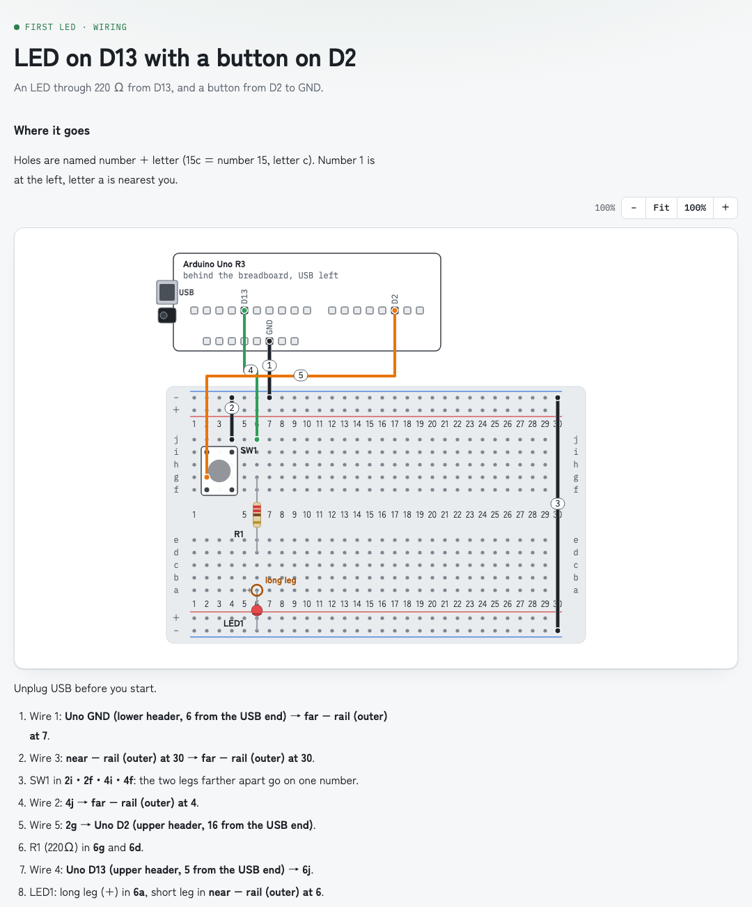

# wiring-guide

[日本語](README.ja.md)

**See how to wire it at a glance, instead of reading it from a list of hole numbers.**

An agent skill for hardware builds, packaged as a Claude Code plugin. When you ask where a wire goes, which hole to use, where to solder or where to probe with a multimeter, the AI answers with an illustrated page instead of paragraphs of hole numbers, and keeps an index page of every guide and how far the build has come.

<picture>
  <source media="(prefers-color-scheme: dark)" srcset="docs/example-dark.png">
  
</picture>

## Install

The skill is a plain [Agent Skills](https://agentskills.io) folder (`skills/wiring-guide/`: `SKILL.md` plus the files it uses), so any AI tool that reads `SKILL.md` can use it.

**Claude Code**

```
/plugin marketplace add shunyakoide/wiring-guide
/plugin install wiring-guide@wiring-guide
```

Or copy `skills/wiring-guide/` into `~/.claude/skills/`.

**Claude apps (claude.ai, desktop)**: zip the `skills/wiring-guide/` folder and upload it under Settings → Capabilities → Skills. Turn on code execution so `breadboard.py` and `render_index.py` can run.

**Claude API and Agent SDK**: load `skills/wiring-guide/` as a custom skill.

**Other AI tools** (GitHub Copilot, Codex, Cursor and others that support Agent Skills): copy `skills/wiring-guide/` into the tool's skills folder; see its docs for where that is. Only Claude Code has been tested so far.

## Usage

Talk about your build as usual ("where does the LED's resistor go?", "check my encoder wiring"). The skill triggers on its own.

- Each guide draws only what to check now, with both ends of every wire, numbered to match a wire table.
- Progress lives in one Markdown file outside your repository (default `~/.wiring-guide/<repo>/progress.md`). See [skills/wiring-guide/progress.example.md](skills/wiring-guide/progress.example.md).
- `breadboard.py` builds a breadboard page from a short list of parts and what connects to what: it picks the holes, adds the wires and steps, and checks for common mistakes and electrical hazards. See [skills/wiring-guide/spec.example.json](skills/wiring-guide/spec.example.json).
- `render_index.py` turns that file into the index page. Both need only Python 3.

## Safety

Before it draws a breadboard page, `breadboard.py` checks the nets for shorts, 5 V on 3.3 V pins, missing or too-small LED resistors, reversed parts and pins over their limit. A dangerous circuit gets no page. The skill looks up voltages and pin orders in `boards/` and datasheets, and asks you when it cannot confirm one instead of guessing.

These checks only see what the spec says. They do not prove a circuit safe: pin orders, motors, relays, total current and hand-drawn pages are not checked by the script, and each answer says what was and was not checked. Check it yourself before you power anything you could not afford to lose.

## Tests and evals

```
python3 -m unittest discover tests
claude plugin eval . --ablation none --no-publish --max-cost-usd 10 --allow-tools Bash Write Edit Read
```

The first needs only Python and covers the scripts. The second calls a model and costs money. [evals/README.md](evals/README.md) says what each proves and what still needs a person.

Pages are published with Claude's Artifact tool when it is available. Elsewhere they are written as local HTML files and opened in a browser, which works with any tool that can write files.

## Acknowledgements

Some checks in the skill were adapted from other MIT-licensed skills. The text was rewritten, not copied, and the board facts were checked against the datasheets linked in each `boards/` file.

- [embedded-engineering-skills](https://github.com/wedsamuel1230/embedded-engineering-skills) by Samuel F. (MIT, © 2026 Samuel F.)
  - [circuit-debugger](https://github.com/wedsamuel1230/embedded-engineering-skills/tree/main/skills/circuit-debugger): measuring order (power off, then on), expected voltages, common breadboard mistakes, the idea of a test sketch after wiring
  - [wiring-safety-check](https://github.com/wedsamuel1230/embedded-engineering-skills/tree/main/skills/wiring-safety-check): checking the circuit before drawing it
  - [board-support](https://github.com/wedsamuel1230/embedded-engineering-skills/tree/main/skills/board-support): per-board pin notes with a source for each fact
  - [embedded-project-loop](https://github.com/wedsamuel1230/embedded-engineering-skills/tree/main/skills/embedded-project-loop): one step at a time, with the expected result
- [legacy-circuit-mockups](https://github.com/github/awesome-copilot/tree/main/skills/legacy-circuit-mockups) in github/awesome-copilot (MIT, © GitHub, Inc.): split power rails, signal wire colors

## License

[MIT](LICENSE). The skill folder carries a copy (`skills/wiring-guide/LICENSE.txt`) so the license stays with it when the folder is copied or zipped on its own.
